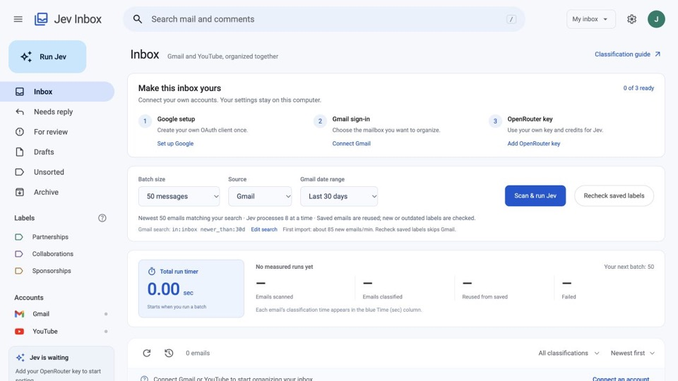

# Jev Inbox

A minimalist local dashboard for sorting Gmail and YouTube comments with Jev through OpenRouter. Connect your own accounts and keep the workspace on your computer.

[Download the ready-to-run ZIP](https://github.com/honeyychawla/jev-inbox/releases/latest) · [First-run guide](FIRST_RUN.md) · [One-shot setup prompt](ONE_SHOT_PROMPT.md) · [Build prompt](BUILD_PROMPT.md)



## Start locally

1. Install [Node.js LTS](https://nodejs.org/en/download). Node 22.13+ is required; current LTS is recommended.
2. Download the release ZIP and **extract it completely**.
3. Start the app:

| Your computer | Launcher |
|---|---|
| macOS | Double-click `Start Jev Inbox.command` |
| Windows | Double-click `Start Jev Inbox.cmd` |
| Linux | Run `sh start.sh` in the extracted folder |
| Any OS, using a terminal | Run `npm start` in the project folder |

Open **http://localhost:5184**. Keep the terminal open while using the dashboard. Press Ctrl+C to stop it. There are no npm dependencies to install, no Docker requirement, and no hosted service to deploy.

If macOS cannot open the launcher, open Terminal in the extracted folder and run `npm start`. No need to disable security settings. If Node was just installed, reopen your terminal first.

## Connect your own accounts

The first-run checklist opens the right setup screen for each step:

1. **Google setup:** create your own Google Cloud OAuth web client and paste its client ID and secret in **Settings → Connections**. Follow the [Google setup guide](docs/google-setup.md). This is required once for each person's local installation.
2. **Gmail sign-in:** click **Connect Gmail** and choose your own account in Google's consent screen.
3. **OpenRouter:** create your own key at [OpenRouter](https://openrouter.ai/settings/keys), add credits if needed, then paste it in **Settings → OpenRouter → Save & test connection**. The default model is `typesafe/jev-1.14`.

The exact Google callback URL for the default port is:

```text
http://localhost:5184/auth/google/callback
```

You can explore the clearly marked sample inbox before connecting anything. Each copy starts without live emails, accounts, keys, or OAuth credentials. After sign-in, switch to **My inbox** and choose **Scan & run Jev**.

YouTube is optional. Enable YouTube Data API v3 in your own Google project and connect the account that owns your channel through Settings.

## What it does

- Gmail-style interface, search, source filters, labels, priorities, drafts, and a reading view.
- 17 classifications, including Partnerships, Collaborations, Sponsorships, Press & interviews, Events & speaking, Customer support, Billing & payments, Questions, Feedback, Appreciation, Newsletters, Promotions, Notifications, Security, Other business, Spam, and Other.
- Batch sizes of **50, 100, 250, 500, or 1,000** individual emails/comments. Gmail's default search is `in:inbox newer_than:30d`; change the date range or search in the dashboard.
- **Scan & run Jev** checks Gmail and classifies new, changed, or outdated messages. Complete saved emails are reused to reduce downloads.
- **Recheck saved labels** runs Jev on saved messages without downloading Gmail again. Your manual category corrections and written drafts are preserved.
- Blue **Time (sec)** column per email, total run timer, separate provider/Jev timings, scanned/classified/reused/downloaded counts, failures, and run history.
- Bounded parallel classification, paced Gmail reads, retry backoff, and a Stop run control that saves completed work.
- Uncertain labels and sensitive messages go to **For review**, with reasons. Label confidence is a model score, not measured accuracy.

Jev is a decision model: it selects categories, priorities, reply needs, and an editable reply template. It does not write free-form responses. Every outgoing reply requires your review and confirmation of its exact recipient and text. Labels and archive actions are local to this dashboard; they do not modify Gmail labels or YouTube moderation state.

## Speed and limits

The batch limit counts **individual emails**, not grouped Gmail conversations. The search is checked newest first. A higher limit scans more matching emails; it does not create duplicate stored messages.

Eight Jev requests can run concurrently. Gmail full-body downloads are paced at approximately 85 new emails per minute to stay below [Google's current new-project quotas](https://developers.google.com/workspace/gmail/api/reference/quota). Importing 1,000 entirely new emails can therefore take roughly 12 minutes plus classification time. Repeat scans and rechecks of saved messages are much faster. Actual timing depends on the providers, your connection, and message length.

Automatic sync every five minutes is optional and off by default. It only runs while the local server is open. The scan size, source, and search apply to automatic runs too.

## Your data

The server listens only on `127.0.0.1`. Messages, preferences, drafts, and encrypted credentials are created in `data/` after you run the app. The key file and database must stay together on your computer. Encryption does not protect against someone who can read both files.

Google login happens on Google's website. When you run Jev, the selected message content is sent to OpenRouter for classification. Local hosting does not mean the model runs offline. Opening the sample inbox alone makes no provider calls.

**Do not share your `data/` directory, `.env` files, OAuth downloads, or credentials.** The Git ignore rules exclude common private files. The published release ZIP contains only application files, documentation, licensed UI assets, and fictional samples. Download a fresh release ZIP when sharing with someone else.

## Updates and development

Keep your existing `data/` directory private when updating. Stop the server before replacing application files. A fresh ZIP should never overwrite your private database; keep a private backup first.

```bash
npm run check
npm test
```

Tests use temporary databases and mocked providers. They do not send real emails or use API credits. CI runs the checks on macOS, Windows, and Linux. `npm run check:share` checks a clean release tree for runtime files and recognizable credential patterns; it intentionally fails if a local `data/` directory is present.

Google Material Symbols and Roboto are included with their licenses. Gmail and YouTube logos identify the integrations. See [asset attribution](public/assets/ATTRIBUTION.md). Jev Inbox is an independent local application.

## Troubleshooting

See [FIRST_RUN.md](FIRST_RUN.md) for launch problems and [docs/google-setup.md](docs/google-setup.md) for OAuth errors, test-user access, token expiry, and redirect URLs. For a public issue, share the error message and Node version; omit email content, keys, tokens, and the database.

